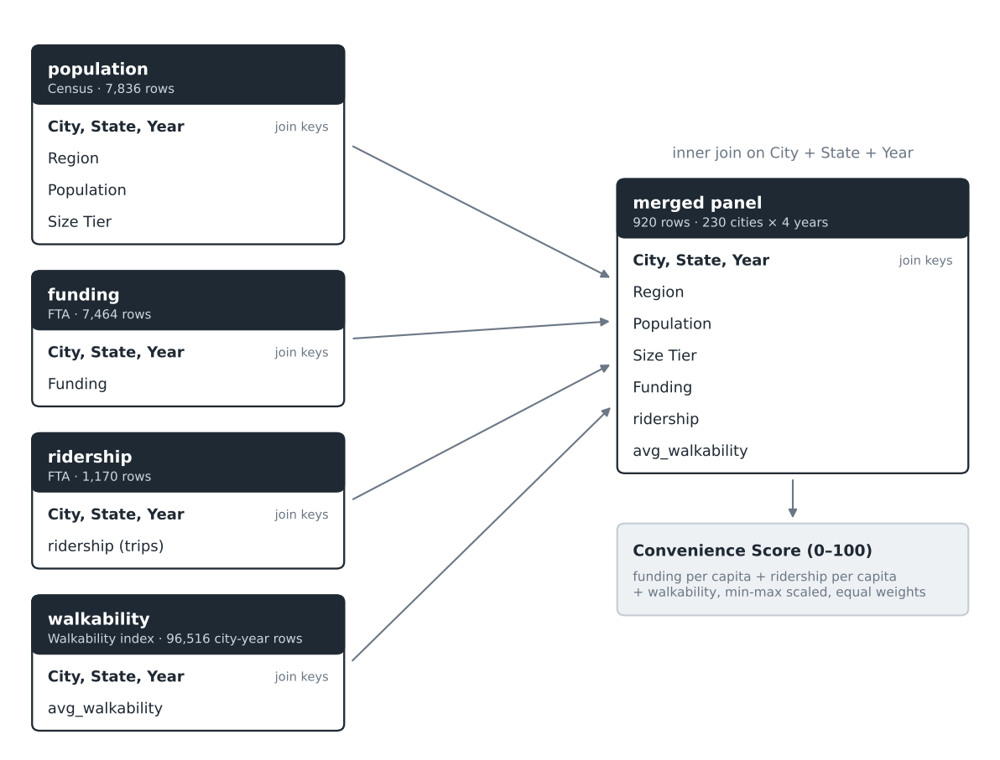
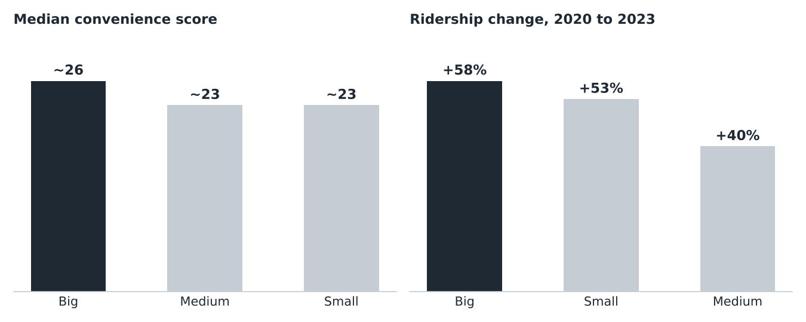
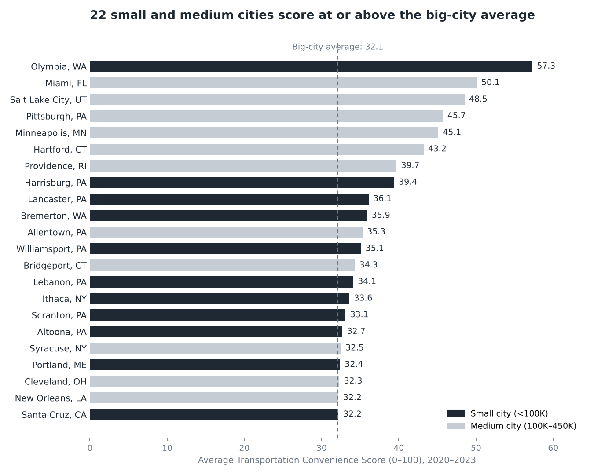

# Transportation Convenience Across 230 U.S. Cities (2020–2023)

A Transportation Convenience Score (0–100) that compares U.S. cities on public transit funding, transit ridership, and walkability, built for people who live without a car.

**Tools:** Python, pandas, GeoPandas, seaborn, matplotlib | **Technical detail:** [analysis notebook](A03-Transportation-Convenience-Across-US%20cities.ipynb)

---

## Background & Overview

Students and recent graduates relocating for school or work often choose to live without a car to avoid the cost of owning one. Transit in the largest metros is well documented. Transit convenience in small and mid-size cities is not, and comparing cities means reading funding, ridership, and walkability data from separate public sources.

This project combines those sources into a single score so cities can be compared on one scale. The score supports decisions for car-free movers, and for the planning and advisory teams who support them.

**The analysis covers:**
- Convenience by city size tier: Small (under 100K), Medium (100K–450K), Big (450K+)
- Small and medium cities that perform at big-city levels
- Whether population growth is associated with better convenience
- Which components (funding, ridership, walkability) drive a city's score
- Regional gaps

**Scope:** 230 cities, 2020–2023, 920 city-year observations.

---

## Data Structure Overview

Six public sources were cleaned and joined into one city-year table on City, State, and Year. Walkability was measured at the census block-group level and rolled up to the city level with a spatial join.

| Source | Provider | Used for |
|---|---|---|
| City and town population estimates | U.S. Census Bureau | Population, size tier, region |
| Total funding time series | Federal Transit Administration (FTA) | Transit funding |
| Monthly ridership (unlinked passenger trips) | FTA National Transit Database | Transit ridership |
| Walkability index, 2017–2023 | Social Data Commons (UVA) | Walkability |
| National Walkability Index, 2010 vintage | U.S. EPA | Block-group boundaries and scores |
| 2010 Census place boundaries | U.S. Census Bureau | City boundaries for the spatial join |

**Convenience Score:** funding per capita, ridership per capita, and walkability, each min-max scaled and weighted equally into a 0–100 score.

---

## Executive Summary

**Big cities score highest on transportation convenience, with a median score of about 26 against about 23 for medium and small cities.** Their ridership also rebounded the most between 2020 and 2023. The gap between tiers is small compared with the spread inside each tier, and 22 small and medium cities score at or above the big-city average of 32.1. Population growth had almost no relationship with changes in convenience, so a fast-growing city is not automatically an easier one to live in without a car.

| **22** | **0.03** | **+58%** |
|:---|:---|:---|
| small and medium cities score at or above the big-city average | correlation between population growth and change in score | ridership change in big cities, 2020 to 2023 |

---

## Insights Deep Dive

### 1. Big cities lead, and the lead is growing

Big cities averaged about 31 in 2020 and about 34 in 2023, with most of the gain after 2021. Medium and small cities stayed roughly flat. Ridership rose in every tier since 2020, most in big cities.

| Tier | Average score, 2020 to 2023 | Median score | Ridership change, 2020 to 2023 |
|---|---|---|---|
| Big (450K+) | about 31 to about 34, up | about 26 | +58% |
| Medium (100K–450K) | about 23, flat | about 23 | +40% |
| Small (under 100K) | about 22, flat | about 23 | +53% |

### 2. 22 small and medium cities match the big-city average

Using the big-city average of 32.1 as the benchmark, 11 small and 11 medium cities meet or exceed it. Olympia, WA leads at 57.3, followed by Miami (50.1), Salt Lake City (48.5), Pittsburgh (45.7), and Minneapolis (45.1).

### 3. Population growth does not explain convenience

Across 230 cities, population growth from 2020 to 2023 and the percent change in score have a correlation of about 0.03. Cities that grew did not reliably get easier to live in without a car.

<b>More detail: what drives the score, and regional gaps</b>

#### Walkability carries the most weight

Walkability has the strongest correlation with the overall score (0.85), followed by ridership (0.77) and funding (0.70). These correlations are partly built into the formula, since all three feed the score. Top cities get there in different ways: Boston and Washington are balanced, Seattle and San Francisco lean on walkability, and Olympia leans on funding. Among the bottom five, Sherman gets about 95% of its score from walkability and Evansville about 88%, with very little transit funding or ridership. Growth is also close to unrelated to each component: walkability 0.09, funding 0.02, ridership −0.08.

#### Region matters as much as size

The Northeast has the highest average in every tier, and big Northeastern cities average 55.7. Big cities score highest within every region. Small and medium Southern cities score lowest, at 15.3 and 18.9, against 28.3 and 33.0 in the Northeast. In every region, small cities score low on funding and ridership while walkability holds up, which is the largest sub-metric gap in the data.

*These two charts are exported from the notebook in its original styling. The notebook has all 15 charts.*

---

## Recommendations

These are suggestions to explore, based on patterns in the 2020–2023 data. They are not proven causes.

**For student housing and relocation advisors**
1. **Add smaller cities to the comparison.** Olympia (57.3), Miami (50.1), Salt Lake City (48.5), Pittsburgh (45.7), and Minneapolis (45.1) all score above the big-city average of 32.1, so they belong next to big-city options.
2. **Check transit before recommending a walkability-driven city.** Sherman (about 95% of its score from walkability) and Evansville (about 88%) have very little transit funding or ridership behind their scores. Confirm actual service first.
3. **Rank by components, not size or growth.** Growth had a correlation of 0.03 with score change, and tier medians differ by only about 3 points.

**For transit planners and policy analysts**
1. **Review funding and service in small cities.** Small cities in every region score low on funding and ridership even where walkability is fine, so they are the clearest place to find a gap.
2. **Start with the South.** Small Southern cities average 15.3 against 28.3 in the Northeast, and medium Southern cities 18.9 against 33.0.
3. **Study Olympia's funding.** It is a small city with the top score in the data, and funding is about 53% of its score.

**Next steps to explore:** add commute time, service frequency, and fares to the score, then test regression models (Random Forest, XGBoost) to build a national index.

---

## Caveats & Assumptions

- **Joining the data took real cleanup.** The sources use four different geographies: cities, transit agency headquarters, urbanized areas, and block groups. City names were standardized with string cleaning, and many records that did not match across sources were dropped to produce a clean dataset of 230 cities.
- **Geographic mismatch remains.** Population is reported by city, while ridership and funding are reported by agency or urbanized area.
- **Equal weights are a modeling choice.** Other weightings would change the rankings.
- **The window includes COVID-19.** 2020–2023 covers the ridership drop and recovery, so ridership trends need careful reading.
- **Funding is not service quality.** Higher funding does not guarantee better frequency or coverage.
- **Findings are correlations, not causes.** Income, density, car ownership, and land use are not controlled for.

---

## Repository

| File | What it is |
|---|---|
| `A03-Transportation-Convenience-Across-US cities.ipynb` | Full analysis: cleaning, merging, scoring, and 15 charts |
| `data/` | Input datasets |
| `images/` | Charts and diagrams used on this page |
| `index.html` | Same write-up as a GitHub Pages site |

The notebook was written in Google Colab and reads from Google Drive paths (`/content/drive/...`). To run it elsewhere, update the file paths and download the datasets listed in its References section.

## Team

Team 3: Ryan Jiang, Chenxi Wu, Jingyu Zhang, Tobey Fung (Project Manager)

Generative AI tools (Gemini, ChatGPT) were used for code assistance and phrasing. All data, visuals, and analyses come from the sources and notebook.
