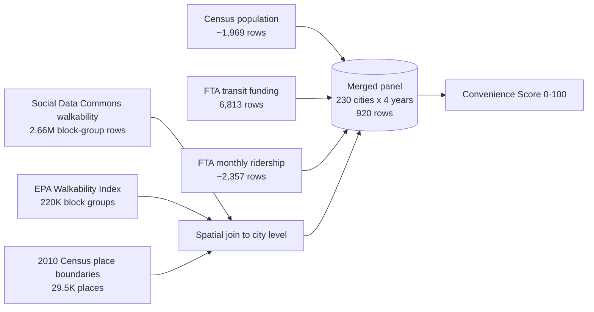
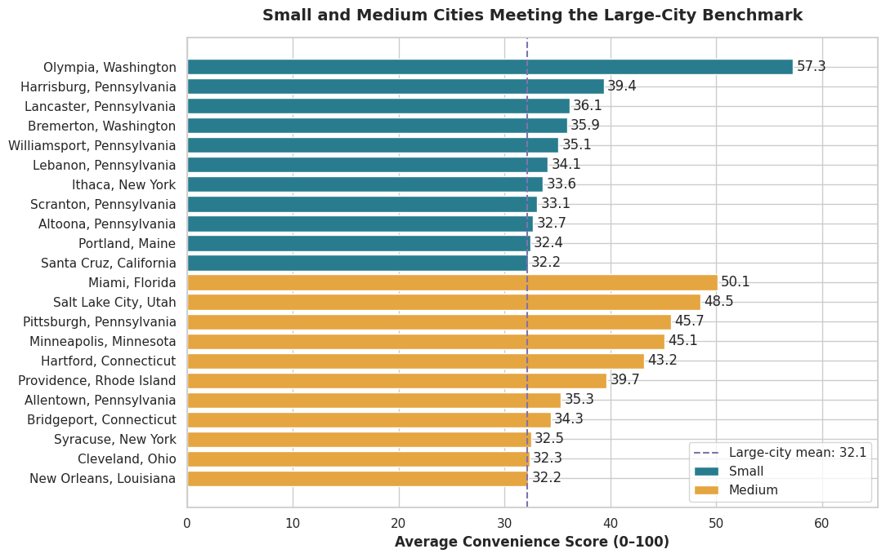
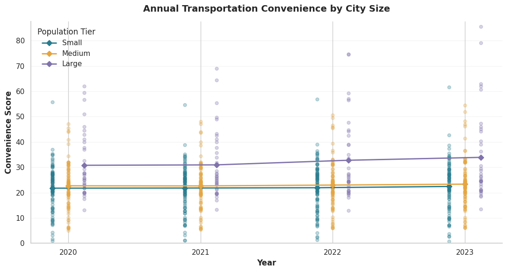
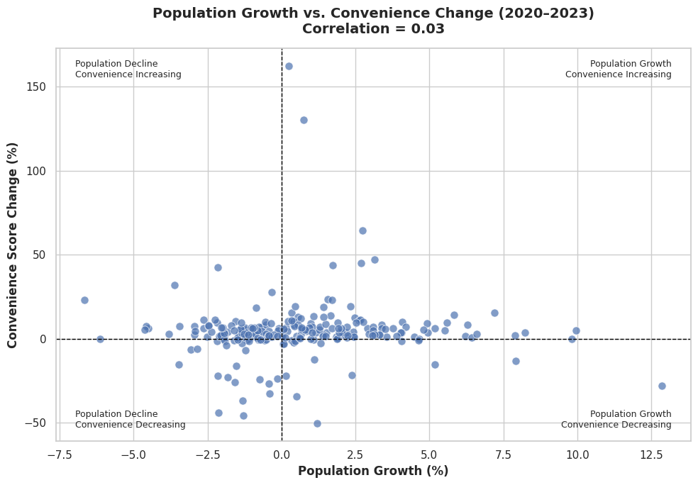
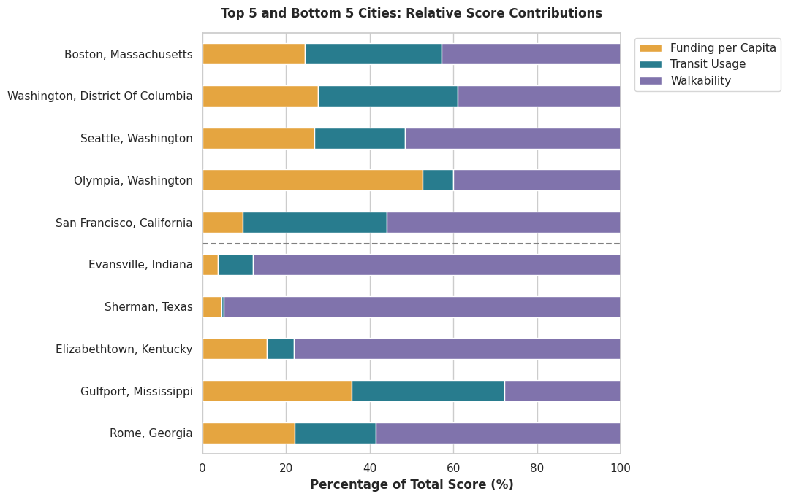
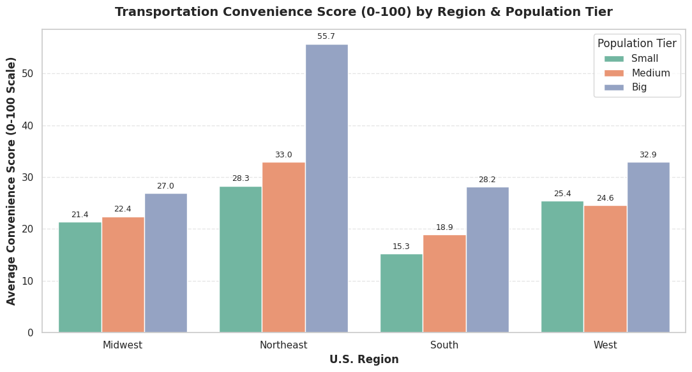
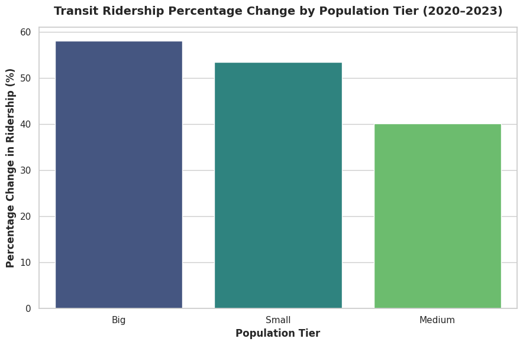

# Where Can You Live Without a Car? Transportation Convenience Across 230 U.S. Cities (2020–2023)

**Python · pandas · GeoPandas · seaborn · matplotlib** | BU MSBA, Team 3 project

> **Short on time?** Jump to the [Executive Summary](#executive-summary) or the [Recommendations](#recommendations).

---

## Background & Overview

Students and recent grads who skip car ownership need to know which cities are actually easy to live in without one. Big-city transit is well studied. Small and mid-size cities are not, and comparing them means juggling funding, ridership, and walkability across different data sources.

**What we built:** a **Transportation Convenience Score (0–100)** for **230 U.S. cities** across **2020–2023** (920 city-year rows).

**Questions we answered:**
- Which city size tier scores best, and which individual cities beat their size?
- Does population growth make a city easier to get around without a car?
- What is driving a city's score: walkability, transit funding, or ridership?

**City tiers (by 2020 population):** Small (<100K) · Medium (100K–450K) · Big (450K+)

---

## Data Structure Overview

Six public sources, about 2.9M raw rows, merged into one city-year table.

**Score formula:** three components, min-max scaled, weighted equally.

| Component | Measure |
|---|---|
| Transit funding | Funding per capita |
| Transit usage | Unlinked passenger trips per capita |
| Walkability | City-level average of block-group walkability |

**Hardest part:** the sources use four different geographies (cities, transit agency HQs, urbanized areas, block groups). We standardized names with string cleaning and used GIS spatial joins to roll walkability up to the city level.

---

## Executive Summary

**Big cities score highest, but size is not the whole story.** 22 small and medium cities match or beat the big-city average (32.1), and population growth had almost no link to convenience (r ≈ 0.03).

- **Big cities lead:** median score ~26 vs ~23 for medium and small, and the best ridership recovery since 2020 (~58%).
- **Small and mid-size cities can match them:** Olympia (57.3), Miami (50.1), Salt Lake City (48.5), Pittsburgh (45.7), Minneapolis (45.1).
- **Region matters:** the Northeast leads every tier. Small Southern cities score lowest (15.3).
- **Growth does not predict convenience:** a fast-growing city is not automatically easier to live in without a car.

---

## Insights Deep Dive

### 1. Big cities win on average, but the tiers overlap a lot
Big cities rose from ~31 to ~34 between 2020 and 2023. Medium (~23) and small (~22) stayed mostly flat. The spread inside each tier is larger than the gap between tiers, so size alone does not decide a city's score.

### 2. Population growth does not explain convenience
Across all 230 cities, the correlation between 2020–2023 population growth and change in score is about **0.03**. Growth is also close to unrelated to each component: walkability 0.09, funding 0.02, ridership -0.08.

### 3. Walkability does the most work, and some cities rely on it too much
Walkability has the strongest link to the score (0.85), then ridership (0.77) and funding (0.70). Part of that is built into the formula. Top cities get there differently: Boston and Washington are balanced, Seattle and San Francisco lean on walkability, and Olympia leans on funding. Several bottom-ranked cities, like Sherman (~95%) and Evansville (~88%), get almost all of their score from walkability and have very little transit.

### 4. Region matters as much as size
The Northeast has the highest average in every tier (big cities average 55.7), and big cities score highest within every region. Small and medium Southern cities score lowest (15.3 and 18.9). Across all regions, small cities score low on funding and ridership while walkability holds up, which is the largest sub-metric gap.

### 5. All tiers recovered ridership, and small cities get slightly more trips per dollar
Ridership rose from 2020 to 2023 in every tier: big ~58%, small ~53%, medium ~40%. Trips per funding dollar are similar across tiers (small ~0.083, medium ~0.079, big ~0.077), so the gap is small.

More charts (all 15) are in the [notebook](A03-Transportation-Convenience-Across-US%20cities.ipynb).

---

## Recommendations

**For students and recent grads choosing a city**
1. **Compare cities, not size tiers.** Look at the score and its three parts for each city you are considering.
2. **Check the shortlist of smaller cities.** If you want big-city convenience at a smaller scale, start with Olympia, Salt Lake City, Pittsburgh, Minneapolis, Harrisburg, or Lancaster.
3. **Check what is driving the score.** A high score built on walkability alone may still lack frequent transit. Look at ridership and funding before you commit.
4. **Do not use population growth as a shortcut.** A booming city is not automatically easier to live in without a car.

**For city planners and policymakers**
1. **Judge transit outcomes, not growth.** Growth did not translate into better convenience.
2. **Target the gap.** Small cities in every region score low on funding and ridership even where walkability is fine.

---

## Caveats & Assumptions

- **Simplified score:** equal weights are a modeling choice. Other weightings would change the rankings.
- **Geographic mismatch:** population is by city, while ridership and funding are by transit agency or urbanized area.
- **COVID-19 window:** 2020–2023 covers the pandemic drop and recovery, so ridership trends need careful reading.
- **Funding is not service quality:** more funding does not guarantee better frequency or coverage.
- **Not causal:** correlations only. Income, density, car ownership, and land use are not controlled for.
- **Not included:** commute times, service frequency, fares.

**Next steps:** add commute time, frequency, and fares, then test regression models (Random Forest, XGBoost) to build a national index.

---

## Repository

| File | What it is |
|---|---|
| `A03-Transportation-Convenience-Across-US cities.ipynb` | Full analysis, with cleaning, merging, scoring, and 15 charts |
| `data/` | Input datasets |
| `images/` | Charts used in this README and the project page |
| `index.html` | Project page for GitHub Pages |

**To run it:** the notebook was written in Google Colab and reads from Google Drive paths (`/content/drive/...`). Update the file paths and download the datasets listed in the notebook's References section. Core libraries: `numpy`, `pandas`, `seaborn`, `matplotlib`, `geopandas`.

## Team

Team 3 (Thomas): Ryan Jiang, Chenxi Wu, Jingyu Zhang, Tobey Fung (Project Manager)

*Generative AI tools (Gemini, ChatGPT) were used for code assistance and phrasing. All data, visuals, and analyses come from the sources and notebook.*
